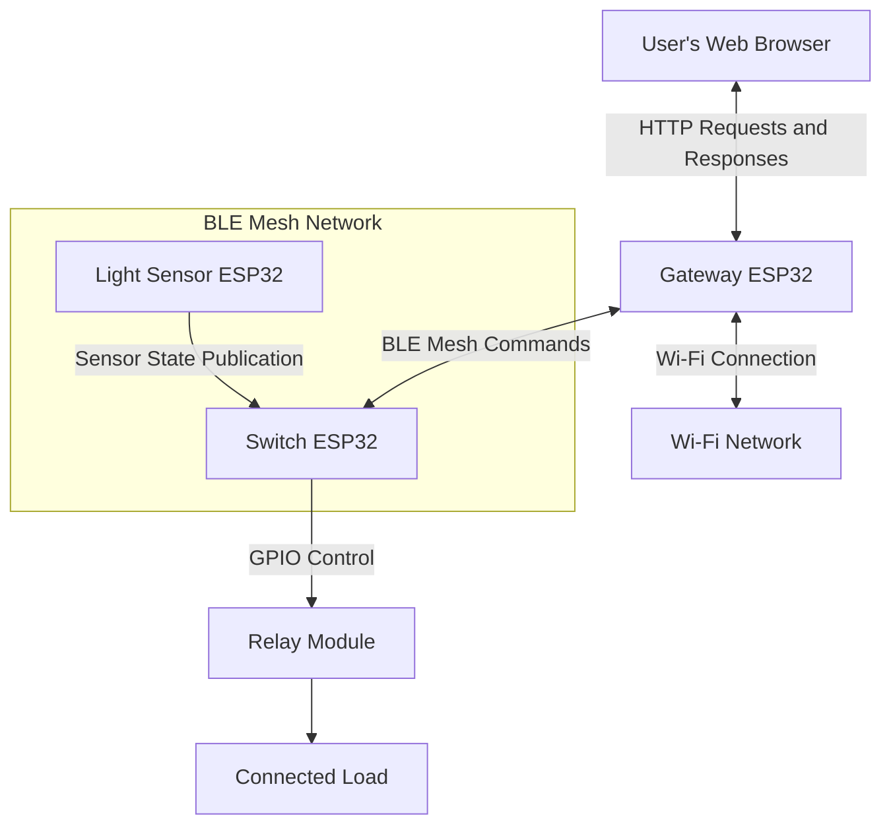

# ESP32 Smart Home BLE Mesh System

A wireless smart home automation system built using **ESP32 microcontrollers** and **Bluetooth Low Energy (BLE) Mesh**. The project uses three ESP32 nodes to provide automatic lighting control through an ambient light sensor and manual control through a web-based interface hosted by the Gateway.

---

## 📌 Project Overview

This project demonstrates a distributed smart home system using BLE Mesh communication. Instead of relying on a single ESP32 to handle every operation, the system separates its functions into three nodes:

- **Gateway** – Handles Wi-Fi connectivity and provides the web interface.
- **Switch** – Receives BLE Mesh commands and controls the relay.
- **Light Sensor** – Monitors ambient light and sends its detected state through BLE Mesh.

The Light Sensor monitors the surrounding light level and publishes its detected state through the BLE Mesh network. The Switch receives the sensor's messages and controls a relay connected to a load. Meanwhile, the Gateway provides a web interface that allows users to manually turn the connected load ON or OFF.

The system uses **BLE Mesh** for communication between the ESP32 nodes, while **Wi-Fi** provides connectivity between the Gateway and the user's web browser.

---

## ✨ Features

- **Automatic Lighting Control** – Detects dark and bright conditions using an LDR sensor.
- **Manual Web Control** – Allows users to turn the connected load ON or OFF through a webpage.
- **BLE Mesh Communication** – Enables wireless communication between the three ESP32 nodes.
- **Distributed Architecture** – Separates system operations into Gateway, Switch, and Light Sensor nodes.
- **Relay Control** – Controls a connected load through a relay module.
- **Provisioned Network Restoration** – Restores saved BLE Mesh provisioning information after restarting without requiring provisioning again.
- **Wi-Fi Connectivity** – Allows users to access the Gateway's web interface through a local network.

---

## 🎯 Learning Objectives

This project demonstrates the following concepts:

- ESP32 development using PlatformIO and ESP-IDF.
- Bluetooth Low Energy Mesh networking.
- BLE Mesh provisioning and node configuration.
- Generic OnOff Client and Server models.
- BLE Mesh application key management and model binding.
- Group addressing and message publication.
- GPIO input and output control.
- Wi-Fi connectivity and HTTP web server implementation.
- Communication between distributed microcontroller nodes.
- Persistent storage of BLE Mesh configuration.

---

## 🏗️ System Architecture

The system consists of three ESP32 nodes, each with a specific responsibility.

### 1. Gateway Node

The Gateway acts as the main interface between the user and the BLE Mesh network.

**Responsibilities:**
- Connects to a Wi-Fi network.
- Hosts the web server and control webpage.
- Receives manual ON/OFF commands from the webpage.
- Sends Generic OnOff commands to the BLE Mesh network.
- Uses the All Nodes address (`0xFFFF`) to send commands to the mesh nodes.

### 2. Switch Node

The Switch receives commands through BLE Mesh and controls the connected relay.

**Responsibilities:**
- Receives manual ON/OFF commands from the Gateway.
- Receives sensor state messages from the Light Sensor.
- Controls the relay connected to GPIO 4.
- Provides the Generic OnOff Server and Client models required by the system.

### 3. Light Sensor Node

The Light Sensor monitors the surrounding light level using an LDR sensor module.

**Responsibilities:**
- Reads the digital output of the LDR module.
- Determines whether the environment is DARK or BRIGHT.
- Publishes its ON/OFF state through BLE Mesh.
- Sends its state to the All Nodes address (`0xFFFF`).

---

## 📡 Communication Overview

| Communication | Purpose |
|---|---|
| Wi-Fi | Connects the Gateway to the user's web browser. |
| BLE Mesh | Handles communication between the three ESP32 nodes. |
| GPIO | Reads the LDR output and controls the relay. |
| HTTP | Transfers manual control commands between the webpage and Gateway. |

---

## System Communication Flow


## 📡 BLE Mesh Architecture

The project uses **Bluetooth Low Energy (BLE) Mesh** to allow the three ESP32 nodes to communicate wirelessly within a shared mesh network.

All three nodes are provisioned into the same BLE Mesh network using the **nRF Mesh mobile application**. Each node is assigned a unique unicast address and configured with the required BLE Mesh models and Application Key.

### 1. Network Configuration

The following table shows the BLE Mesh network configuration used in the project.

| Configuration | Value |
|---|---|
| Mesh Network Name | `SmartHome` |
| Application Key Name | `SmartHome_AppKey` |
| Application Key Index | `0` |
| All Nodes Address | `0xFFFF` |
| Provisioning Application | nRF Mesh |

### 2. Provisioned Node Addresses

Each ESP32 node is assigned a unique BLE Mesh Primary Address during provisioning.

| ESP32 Node | Primary Address |
|---|---|
| Gateway | `0x0002` |
| Switch | `0x0003` |
| Light Sensor | `0x0004` |

> **Note:** These addresses represent the current provisioning setup. They may change if the BLE Mesh network is recreated or the nodes are provisioned again.

### 3. BLE Mesh Models

The project uses the **Bluetooth Mesh Generic OnOff Model** to handle ON/OFF communication between nodes.

Each node has a specific model depending on its responsibility in the system.

| Node | BLE Mesh Model | Function |
|---|---|---|
| Gateway | Generic OnOff Client (`0x1001`) | Sends manual ON/OFF commands. |
| Switch | Generic OnOff Server (`0x1000`) | Receives commands and controls the relay. |
| Switch | Generic OnOff Client (`0x1001`) | Receives sensor state messages. |
| Light Sensor | Generic OnOff Server (`0x1000`) | Publishes its detected ON/OFF state. |

All models are bound to the shared **Application Key** with index `0` to allow authenticated application-level communication within the mesh network.

### 4. Message Addressing

The project uses the BLE Mesh **All Nodes Address (`0xFFFF`)** to send messages to all nodes in the network.

```text
All Nodes Address: 0xFFFF
Address Type: Group Address
```

The address is used by both the Gateway and Light Sensor:

- **Gateway:** Uses `0xFFFF` when sending manual ON/OFF commands.
- **Light Sensor:** Uses `0xFFFF` when publishing its detected light state.
- **Switch:** Receives relevant messages through its configured Generic OnOff models and subscriptions.

Using a group address allows messages to be delivered to multiple subscribed nodes without specifying each destination individually.

### 5. BLE Mesh Communication Summary

The following table summarizes how the nodes communicate with one another.

| Sender | Destination | Message |
|---|---|---|
| Gateway | All Nodes (`0xFFFF`) | Manual ON/OFF command |
| Light Sensor | All Nodes (`0xFFFF`) | Detected light state |
| Switch | Relay (GPIO 4) | Relay ON/OFF control |

> **Note:** The Switch processes the relevant messages according to its configured models and subscriptions. The relay is controlled locally through GPIO 4.

---
