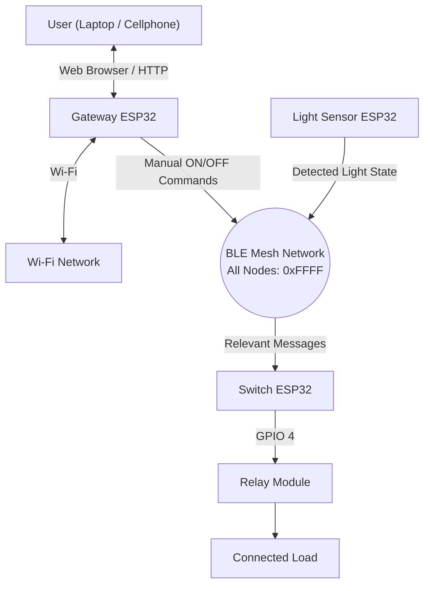

# 🏠 ESP32 Smart Home BLE Mesh System

<p align="center">
  <strong>A wireless smart home system built using ESP32 microcontrollers and BLE Mesh. It uses three ESP32 nodes for automatic lighting based on light detection and manual control through the Gateway's web interface.</strong>
</p>

<p align="center">
  
  
  
  
  
</p>

---
## 📑 Table of Contents

- [Project Overview](#-project-overview)
- [Features](#-features)
- [Learning Objectives](#-learning-objectives)
- [System Architecture](#️-system-architecture)
- [BLE Mesh Architecture](#-ble-mesh-architecture)
- [Hardware and Components](#-hardware-and-components)
- [Pin Configuration](#pin-configuration)
- [How the System Works](#how-the-system-works)
- [Repository Structure](#repository-structure)
- [Development Environment](#development-environment)
- [Getting Started](#getting-started)
- [BLE Mesh Provisioning and Configuration](#ble-mesh-provisioning-and-configuration)
- [Unit Testing](#unit-testing)
- [Functional Verification](#functional-verification)
- [Engineering Decisions](#engineering-decisions)
- [Limitations](#limitations)
- [Future Improvements](#future-improvements)
- [References and Acknowledgments](#references-and-acknowledgments)

---
## 📌 Project Overview

This project demonstrates a distributed smart home system using BLE Mesh communication. Instead of relying on a single ESP32 to handle every operation, the system separates its functions into three nodes:

- **Gateway** – Handles Wi-Fi connectivity and provides the web interface.
- **Switch** – Receives BLE Mesh commands and controls the relay.
- **Light Sensor** – Monitors ambient light and sends its detected state through BLE Mesh.

The Light Sensor monitors the surrounding light level and publishes its detected state through the BLE Mesh network. The Switch receives the sensor's messages and controls a relay connected to a load. Meanwhile, the Gateway provides a web interface that allows users to manually turn the connected load ON or OFF.

The system uses **BLE Mesh** for communication between the ESP32 nodes, while **Wi-Fi** provides connectivity between the Gateway and the user's web browser.

---

## ✨ Features

- **Automatic Lighting Control** – Detects dark and bright conditions using an LDR sensor.
- **Manual Web Control** – Allows users to turn the connected load ON or OFF through a webpage.
- **BLE Mesh Communication** – Enables wireless communication between the three ESP32 nodes.
- **Distributed Architecture** – Separates system operations into Gateway, Switch, and Light Sensor nodes.
- **Relay Control** – Controls a connected load through a relay module.
- **Provisioned Network Restoration** – Restores saved BLE Mesh provisioning information after restarting without requiring provisioning again.
- **Wi-Fi Connectivity** – Allows users to access the Gateway's web interface through a local network.

---

## 🎯 Learning Objectives

This project demonstrates the following concepts:

- ESP32 development using PlatformIO and ESP-IDF.
- Bluetooth Low Energy Mesh networking.
- BLE Mesh provisioning and node configuration.
- Generic OnOff Client and Server models.
- BLE Mesh application key management and model binding.
- Group addressing and message publication.
- GPIO input and output control.
- Wi-Fi connectivity and HTTP web server implementation.
- Communication between distributed microcontroller nodes.
- Persistent storage of BLE Mesh configuration.

---
## 🏗️ System Architecture

The system consists of three ESP32 nodes: Gateway, Switch, and Light Sensor. The Gateway provides manual control through a web interface using Wi-Fi, while the Light Sensor sends detected light states through BLE Mesh. The Switch receives relevant messages and controls the relay connected to the load.


---
### Communication Flow

- **Gateway:** Allows manual light control through a web interface accessed over Wi-Fi. It sends ON/OFF commands through BLE Mesh.
- **Light Sensor:** Detects DARK or BRIGHT conditions and publishes the corresponding state through BLE Mesh.
- **Switch:** Receives relevant BLE Mesh messages and controls the relay through GPIO 4.
- **Relay:** Turns the connected load ON or OFF based on the Switch node's control signal.
---
## 📡 BLE Mesh Architecture

The project uses **Bluetooth Low Energy (BLE) Mesh** to allow the three ESP32 nodes to communicate wirelessly within a shared mesh network.

All three nodes are provisioned into the same BLE Mesh network using the **nRF Mesh mobile application**. Each node is assigned a unique unicast address and configured with the required BLE Mesh models and Application Key.

### 1. Network Configuration

The following table shows the BLE Mesh network configuration used in the project.

| Configuration | Value |
|---|---|
| Mesh Network Name | `SmartHome` |
| Application Key Name | `SmartHome_AppKey` |
| Application Key Index | `0` |
| All Nodes Address | `0xFFFF` |
| Provisioning Application | nRF Mesh |

### 2. Provisioned Node Addresses

Each ESP32 node is assigned a unique BLE Mesh Primary Address during provisioning.

| ESP32 Node | Primary Address |
|---|---|
| Gateway | `0x0002` |
| Switch | `0x0003` |
| Light Sensor | `0x0004` |

> **Note:** These addresses represent the current provisioning setup. They may change if the BLE Mesh network is recreated or the nodes are provisioned again.

### 📱 Provisioned Nodes in nRF Mesh


<p align="center">
  
</p>

### 3. BLE Mesh Models

The project uses the **Bluetooth Mesh Generic OnOff Model** for ON/OFF communication between nodes.

Each node uses a specific model depending on its role in the system.

| Node | BLE Mesh Model | Function |
|---|---|---|
| Gateway | Generic OnOff Client (`0x1001`) | Sends manual ON/OFF commands. |
| Switch | Generic OnOff Server (`0x1000`) | Receives ON/OFF commands for relay control. |
| Switch | Generic OnOff Client (`0x1001`) | Receives the published light sensor state. |
| Light Sensor | Generic OnOff Server (`0x1000`) | Publishes its detected light state. |

All models are bound to the shared **Application Key** with index `0` to allow communication within the mesh network.

### 4. Message Addressing

The project uses the BLE Mesh **All Nodes Address (`0xFFFF`)**, a group address used to send messages to all nodes in the mesh network.

| Node | Destination Address | Purpose |
|---|---|---|
| Gateway | `0xFFFF` | Sends manual ON/OFF commands. |
| Light Sensor | `0xFFFF` | Publishes the detected light state. |

The Switch node receives relevant messages through its configured BLE Mesh models and subscriptions. This allows it to process sensor updates and manual commands without requiring direct communication with a specific node address.

### 5. BLE Mesh Communication Summary

The following table summarizes the communication between the nodes and the relay.

| Sender | Destination | Message |
|---|---|---|
| Gateway | BLE Mesh Network (`0xFFFF`) | Manual ON/OFF command |
| Light Sensor | BLE Mesh Network (`0xFFFF`) | Detected light state |
| Switch | Relay (GPIO 4) | Relay ON/OFF control |

> **Note:** The Switch node processes the received messages and controls the relay locally through GPIO 4.

---
## 🔧 Hardware and Components


All components are real hardware. Nothing is simulated.

| Component | Quantity | Description |
|---|:---:|---|
| ESP32-WROOM-32 | 3 | Used as the Gateway, Switch, and Light Sensor nodes |
| LDR Sensor Module (LM393) | 1 | Detects the surrounding light level |
| Relay Module | 1 | Controls the connected load |
| LED | 1 | Provides a visual indication on the Light Sensor node |
| USB Cable | 3 | Used to power and program the ESP32 boards |
| Smartphone | 1 | Used for BLE Mesh provisioning |
| Computer / Laptop | 1 | Used for firmware development and webpage access |

> **Note:** The Gateway, Switch, and Light Sensor are separate ESP32 nodes that communicate through BLE Mesh.

---
## 🔌 Pin Configuration


### Switch Node

| ESP32 Pin | Connects to | Purpose |
|---|---|---|
| GPIO 4 | Relay IN1 | Controls the relay |
| VIN (5V) | Relay VCC | Supplies power to the relay module |
| GND | Relay GND | Common ground connection |


### Light Sensor Node

| ESP32 Pin | Connects to | Purpose |
|---|---|---|
| GPIO 34 | LDR Module DO | Reads the digital light detection output |
| VIN (5V) | LDR Module VCC | Supplies power to the LDR module |
| GND | LDR Module GND | Common ground connection |

> **Note:**
> - The LDR module uses its digital output to detect DARK or BRIGHT conditions. The configured dark detection level is `1`.
> - The relay module is active-low. It switches ON when its input is pulled LOW and switches OFF when its input is HIGH.
> - The Gateway does not require additional sensor or relay connections for its current web-control function.

---
## ⚙️ How the System Works

### 1. Automatic Lighting Control

1. The Light Sensor reads the LDR module's digital output.
2. The firmware determines whether the environment is DARK or BRIGHT.
3. When darkness is detected, the Light Sensor publishes an ON state through BLE Mesh.
4. The Switch receives the published state.
5. The Switch activates the relay.
6. When brightness is detected, the Light Sensor publishes an OFF state.
7. The Switch receives the OFF state and deactivates the relay.

**Automatic Control Behavior**

| Light Condition | Sensor State | Relay State |
|:---:|:---:|:---:|
| DARK | ON | ON |
| BRIGHT | OFF | OFF |

### 2. Manual Web Control

1. The Gateway connects to a Wi-Fi network.
2. The Gateway starts its HTTP web server.
3. The user connects a computer or mobile device to the same local network.
4. The user opens the Gateway's IP address in a web browser.
5. The user selects ON or OFF on the webpage.
6. The Gateway sends the corresponding Generic OnOff command to the BLE Mesh network.
7. The Switch receives the command and changes the relay state.

### 🌐 Gateway Web Interface

The Gateway provides a web interface that allows users to manually turn the connected light ON or OFF. The webpage can be accessed using a computer or cellphone connected to the same Wi-Fi network.


<p align="center">
  
</p>
<br>


**Gateway Web Interface Address**

```text
http://192.168.172.77
```

> **Important:**
> - The laptop or mobile device generally needs to be on the same local network as the Gateway, or have another valid network route to its IP address.
> - The BLE Mesh communication between the ESP32 nodes does not depend on this Wi-Fi connection.

---
## 📂 Repository Structure

The project is organized into separate directories for each ESP32 node to make the code easier to manage and maintain.

```text
BCA152_ESP32_SmartHome/
│
├── .pio/
├── .vscode/
│
├── common/
│   ├── ble/
│   │   ├── app_blecommon.c
│   │   └── app_blecommon.h
│   │
│   └── led/
│       ├── app_ledattn.c
│       └── app_ledattn.h
│
├── gateway/
│   ├── .pio/
│   ├── include/
│   ├── lib/
│   ├── src/
│   │   ├── app_ble.c
│   │   ├── app_ble.h
│   │   ├── app_ip.c
│   │   ├── app_ip.h
│   │   ├── app_web.c
│   │   ├── app_web.h
│   │   ├── CMakeLists.txt
│   │   └── main.c
│   ├── test/
│   ├── .gitignore
│   ├── CMakeLists.txt
│   ├── partitions.csv
│   ├── platformio.ini
│   ├── sdkconfig
│   ├── sdkconfig.az-delivery-devkit-v4
│   ├── sdkconfig.ci.bluedroid
│   └── sdkconfig.defaults
│
├── light_sensor/
│   ├── .pio/
│   ├── include/
│   ├── lib/
│   ├── src/
│   │   ├── app_ble.c
│   │   ├── app_ble.h
│   │   ├── app_sensor.c
│   │   ├── app_sensor.h
│   │   ├── CMakeLists.txt
│   │   ├── component.mk
│   │   └── main.c
│   ├── test/
│   ├── .gitignore
│   ├── CMakeLists.txt
│   ├── platformio.ini
│   ├── sdkconfig
│   ├── sdkconfig.az-delivery-devkit-v4
│   ├── sdkconfig.az-delivery-devkit-v4.old
│   ├── sdkconfig.ci.bluedroid
│   └── sdkconfig.defaults
│
├── switch/
│   ├── .pio/
│   ├── include/
│   ├── lib/
│   ├── src/
│   │   ├── app_ble.c
│   │   ├── app_ble.h
│   │   ├── app_sw.c
│   │   ├── app_sw.h
│   │   ├── CMakeLists.txt
│   │   └── main.c
│   ├── test/
│   ├── .gitignore
│   ├── CMakeLists.txt
│   ├── platformio.ini
│   ├── sdkconfig
│   ├── sdkconfig.az-delivery-devkit-v4
│   ├── sdkconfig.az-delivery-devkit-v4.old
│   ├── sdkconfig.ci.bluedroid
│   └── sdkconfig.defaults
│
├── .gitignore
├── light_sensor.fzz
├── README.md
└── switch.fzz
```

### Directory Description

- **`gateway/`** – Contains the firmware for the Gateway ESP32, including its Wi-Fi connection and web server.
- **`switch/`** – Contains the firmware for the Switch ESP32, which receives BLE Mesh messages and controls the relay.
- **`light_sensor/`** – Contains the firmware for the Light Sensor ESP32, which reads the LDR sensor and publishes its detected state.
- **`common/`** – Contains shared BLE Mesh-related code used by the different nodes.
- **`README.md`** – Contains the project documentation and instructions.

## 🛠️ Development Environment

The project uses the following development tools:

| Tool | Purpose |
|---|---|
| Visual Studio Code | Used to write and edit the program code. |
| PlatformIO IDE | Used to build and upload firmware to the ESP32 boards. |
| Espressif ESP-IDF | Development framework used for ESP32 programming. |
| Git and GitHub | Used to track code changes and store the project repository. |
| nRF Mesh Mobile Application | Used to provision and configure the BLE Mesh network. |
| Serial Monitor | Used to view messages and monitor the ESP32 while running. |

### Software Requirements

Make sure the following tools are installed before starting the project:

| Requirement | Description |
|---|---|
| Visual Studio Code | Code editor for the project. |
| PlatformIO Extension | Provides the tools needed to build and upload ESP32 firmware. |
| Git | Used for version control. |
| ESP-IDF Toolchain | Must be installed and configured through PlatformIO.

---
## 🚀 Getting Started

### 1. Clone the Repository

Clone the project from GitHub:

```bash
git clone https://github.com/YOUR_USERNAME/BCA152_ESP32_SmartHome.git
```

Navigate to the project directory:

```bash
cd BCA152_ESP32_SmartHome
```

### 2. Open the Project

Open the repository in Visual Studio Code and make sure PlatformIO is installed.

The project contains three separate PlatformIO environments:

- `gateway`
- `switch`
- `light_sensor`

Open the corresponding project directory when building or uploading firmware.

### 3. Configure Gateway Wi-Fi Credentials

The Gateway uses environment variables for its Wi-Fi credentials.

In PowerShell, configure the variables before building the Gateway:

```powershell
$env:WIFI_SSID = "YOUR_WIFI_SSID"
$env:WIFI_PASS = "YOUR_WIFI_PASSWORD"
```

Replace the example values with your own Wi-Fi network credentials.

The Gateway's PlatformIO configuration reads these variables during compilation. Do not commit actual Wi-Fi credentials to the public repository.

> **Note:**
> - Environment variables must be configured again in a new PowerShell session.

### 4. Build the Firmware

Navigate to the node directory you want to build.

**Gateway:**

```powershell
cd gateway
pio run -e az-delivery-devkit-v4
```

**Switch:**

```powershell
cd switch
pio run -e az-delivery-devkit-v4
```

**Light Sensor:**

```powershell
cd light_sensor
pio run -e az-delivery-devkit-v4
```
### 5. Upload the Firmware

Connect the appropriate ESP32 board through USB and upload the firmware.

Example for the Gateway:

```powershell
pio run -e az-delivery-devkit-v4 -t upload --upload-port COMXX
```

Replace `COMXX` with the correct serial port assigned to your ESP32.

Repeat the process for the Switch and Light Sensor.

### 6. Open the Serial Monitor

To check the firmware output:

```powershell
pio device monitor -p COMXX -b 115200
```

Replace `COMXX` with the correct COM port.

The Serial Monitor can be used to check:

- Provisioning status
- Wi-Fi connection
- Sensor readings
- Relay state changes
- BLE Mesh messages

---
## 🔧 BLE Mesh Provisioning and Configuration

The three ESP32 nodes were provisioned and configured using the **nRF Mesh mobile application** to enable communication within the same BLE Mesh network.

### Provisioning and Configuration Steps

1. Create the `SmartHome` network in the nRF Mesh application.
2. Provision the Gateway, Switch, and Light Sensor.
3. Create and add the shared Application Key `SmartHome_AppKey` (Index `0`) to all nodes.
4. Bind the following models to the shared Application Key:
   - **Gateway:** Generic OnOff Client
   - **Switch:** Generic OnOff Server and Client
   - **Light Sensor:** Generic OnOff Server
5. Configure the Light Sensor publication address to `0xFFFF` using `SmartHome_AppKey`.
6. Save the network configuration.

> **Note:** All nodes must share the same network and Application Key configuration for communication. Once provisioning settings are saved and persistent storage is working, nodes should restore their configuration after restarting without requiring re-provisioning.

---
## 🧪 Unit Testing

The following tests were performed to check whether each ESP32 node and the system's main functions work as expected.

| Test | Expected Result |
|---|---|
| Gateway starts | Gateway restores its BLE Mesh configuration. |
| Switch starts | Switch restores its BLE Mesh configuration. |
| Light Sensor starts | Light Sensor restores its BLE Mesh configuration. |
| Light Sensor detects darkness | Sensor publishes ON. |
| Switch receives ON | Relay activates. |
| Light Sensor detects brightness | Sensor publishes OFF. |
| Switch receives OFF | Relay deactivates. |
| Gateway connects to Wi-Fi | Gateway receives an IP address. |
| Gateway starts its web server | Webpage becomes accessible through the local network. |
| Gateway webpage accessed through a cellphone | Webpage is accessible using a cellphone connected to the same Wi-Fi network. |
| Gateway sends manual ON | Switch activates the relay. |
| Gateway sends manual OFF | Switch deactivates the relay. |
| ESP32 restarts | Saved BLE Mesh provisioning information is restored. |

---
## ✅ Functional Verification

The following results summarize the observed behavior during development.

| Component / Function | Observed Result |
|---|---|
| Gateway BLE Mesh provisioning restoration | Successful |
| Switch BLE Mesh provisioning restoration | Successful |
| Light Sensor BLE Mesh provisioning restoration | Successful |
| Light Sensor DARK detection | Detected |
| Light Sensor BRIGHT detection | Detected |
| Sensor state publication | BLE Mesh publication accepted |
| Sensor-to-Switch communication | Switch received the sensor state changes |
| Relay ON/OFF response | Switch changed relay state according to received sensor messages |
| Gateway Wi-Fi connection | Connected successfully |
| Gateway HTTP web server | Started successfully |
| Gateway webpage accessed through a cellphone | Successfully accessed using a cellphone connected to the same Wi-Fi network |

The Light Sensor and Switch were tested using their Serial Monitors. The Light Sensor reported its detected state and BLE Mesh publication, while the Switch reported the received sensor state and corresponding relay changes.

---
## 💡 Engineering Decisions

| Design Decision | Reason |
|---|---|
| **Separate ESP32 Nodes** | Each node has a specific role: Gateway, Switch, or Light Sensor, making the system responsibilities easier to manage. |
| **BLE Mesh Communication** | Allows the nodes to communicate without depending on the Gateway's Wi-Fi connection. |
| **All Nodes Address (`0xFFFF`)** | Used to send messages to all nodes in the BLE Mesh network. |
| **Persistent Storage** | Saves BLE Mesh configuration so nodes can restore their provisioning after restarting. |
| **Wi-Fi Environment Variables** | Keeps Wi-Fi credentials out of the source code and public repository. |
| **Active-LOW Relay Logic** | The firmware accounts for the relay's LOW signal for ON and HIGH signal for OFF. |

## ⚠️ Limitations

| Limitation | Description |
|---|---|
| **Network Access** | The Gateway webpage is intended for local network access and may not be accessible from separate networks without a valid network route. |
| **Communication Dependency** | The Gateway's Wi-Fi connection is independent of BLE Mesh communication between nodes. |
| **Message Delivery** | BLE Mesh messages may not always reach their intended nodes. |
| **Command Confirmation** | Manual Gateway commands use unacknowledged Generic OnOff messages, so delivery confirmation is not provided for every command. |
| **Configuration Dependency** | System operation depends on proper provisioning, Application Key configuration, and model binding. |
| **Light Detection** | Automatic lighting control depends on the LDR module's digital output and configured detection level. |

---
## 🔮 Future Improvements

The system can be further improved through the following enhancements:

| Improvement | Description |
|---|---|
| **Reliable Message Delivery** | Implement acknowledged commands to verify whether messages are successfully received. |
| **Relay State Feedback** | Display the actual relay state on the Gateway webpage. |
| **Additional Devices** | Integrate more sensor nodes and controlled devices into the BLE Mesh network. |
| **Sensor Filtering** | Improve sensor readings to reduce unnecessary state changes in automatic lighting control. |
| **Web Authentication** | Add authentication to protect the Gateway webpage from unauthorized access. |
| **Long-Term Testing** | Conduct more extended testing, including repeated restarts and power cycles, to evaluate system reliability. |

---
## 📚 References and Acknowledgments

### References
- [ESP-IDF Documentation](https://docs.espressif.com/projects/esp-idf/en/latest/esp32/)
- [ESP-BLE-MESH Documentation](https://docs.espressif.com/projects/esp-idf/en/latest/esp32/api-guides/esp-ble-mesh.html)
- [PlatformIO Documentation](https://docs.platformio.org/en/latest/)
- [Nordic Semiconductor nRF Mesh Documentation](https://docs.nordicsemi.com/)

### Acknowledgments
We would like to acknowledge our instructor, Prof. Paul Rodolf Castor, and the learning resources that helped guide us in developing, configuring, testing, and understanding the ESP32 Smart Home BLE Mesh System as part of our BCA152 course.
